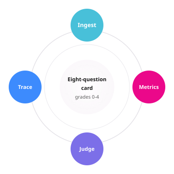

---
hide:
  - title
  - navigation
  - toc
---

  

  

    

      
Post-hoc scorecard toolkit

      <h1 class="aix-hero__title">
        Evaluation for <em class="aix-hero__accent">saved agent runs</em>
      </h1>
      

        Ingest a dump or trace, score 47 metrics, and read an eight-question
        trustworthiness card. Library, CLI, and optional Streamlit UI. Does not
        execute your agent or act as a live safety control.
      

      

        <a class="aix-btn aix-btn--primary" href="getting-started/">Get started</a>
        <a class="aix-btn aix-btn--ghost" href="metric-catalog/">Metric catalog</a>
        <a class="aix-btn aix-btn--ghost" href="https://github.com/VectorInstitute/AIXEval">GitHub</a>
        <a class="aix-btn aix-btn--ghost" href="https://arxiv.org/abs/2609.19524" target="_blank" rel="noopener noreferrer">To read</a>
      

      

        Python &ge; 3.12
        Apache 2.0
        47 metrics
      

    

    

      
    

  

  <strong>Before you upload traces.</strong>
  Do not send personal, confidential, or regulated data to a hosted judge without authorization.
  <a href="privacy-and-data/">Privacy and data</a>

## Explore

-   :material-rocket-launch-outline:{ .lg .middle } __Get started__

    ---

    Install, UI, CLI, and a minimal score flow

    [:octicons-arrow-right-24: Overview](getting-started/index.md)

-   :material-brain:{ .lg .middle } __Concepts__

    ---

    Eight dimensions, bands, hard stops, how to read grades

    [:octicons-arrow-right-24: Overview](concepts/index.md)

-   :material-table-large:{ .lg .middle } __Metric library__

    ---

    All metric ids, mechanisms, and required record fields

    [:octicons-arrow-right-24: Catalog](metric-catalog.md)

-   :material-cog-outline:{ .lg .middle } __How-to__

    ---

    Judges, self-hosting vLLM, privacy

    [:octicons-arrow-right-24: Guides](how-to/index.md)

-   :material-source-branch:{ .lg .middle } __Extend__

    ---

    Add a metric, contribute, run tests

    [:octicons-arrow-right-24: Overview](extending/index.md)

-   :material-information-outline:{ .lg .middle } __About__

    ---

    Acknowledgments, licence, citation, project context

    [:octicons-arrow-right-24: About AIXeval](about/index.md)

## How scoring works

  <article class="aix-step">
    1
    Ingest
    Normalize a dump or trace into one sealed record.
  </article>
  <article class="aix-step">
    2
    Score
    Run metrics. Missing evidence is N/A, never a silent 0.
  </article>
  <article class="aix-step">
    3
    Card
    Aggregate into eight questions; hard stops may cap questions without changing raw scores.
  </article>

[Methodology](methodology.md) for dimensions, bands, and policy cutoffs.

## Implementation status

  <article class="aix-status-card aix-status-card--done"><h3>scorecard</h3>
47 metrics, grading, eight-question card
</article>
  <article class="aix-status-card aix-status-card--done"><h3>ingest</h3>
Dumps, Langfuse, OTel, Patronus, Inspect AI, overlay
</article>
  <article class="aix-status-card aix-status-card--done"><h3>judge</h3>
Claude, OpenAI, Gemini, self-hosted vLLM
</article>
  <article class="aix-status-card aix-status-card--done"><h3>ui</h3>
Streamlit, post-hoc; sidebar picks live judge
</article>
  <article class="aix-status-card aix-status-card--stub"><h3>harness</h3>
Phase 2 (planned): live eval harness; stub today
</article>
  <article class="aix-status-card aix-status-card--stub"><h3>serve</h3>
Phase 2 (planned): hosted scorecard service; stub today
</article>

Phase 2 scope: [Roadmap](about/roadmap.md). [API reference](api.md) for the Python package.

## Acknowledgments

Research supported by the **Province of Ontario**, **CIFAR**, Vector industry
sponsors, and the EU **Horizon AIXPERT** project
([101214389](https://cordis.europa.eu/project/id/101214389)).
[Full acknowledgments](about/acknowledgments.md) ·
[Licence and citation](about/license-and-citation.md)

**Correspondence:** [Email](mailto:shaina.raza@vectorinstitute.ai)

